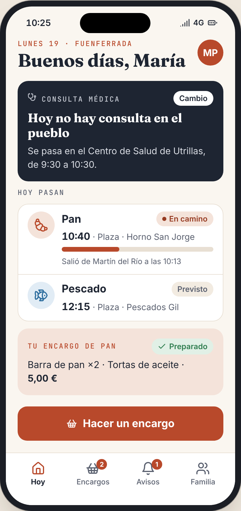
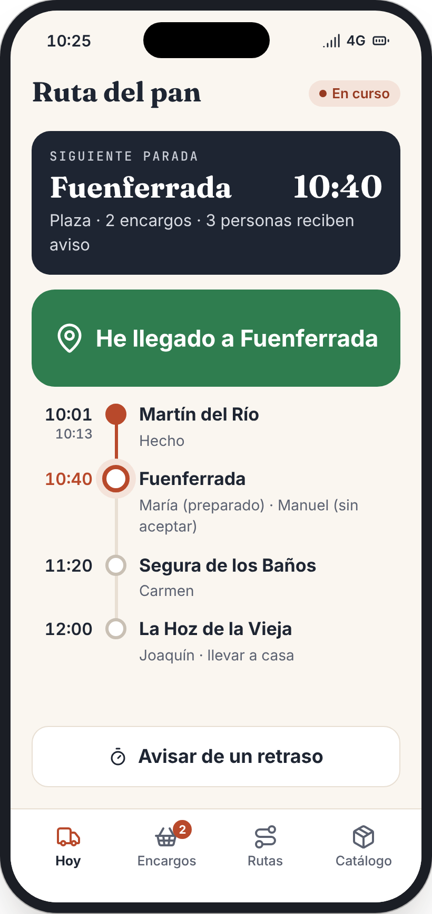
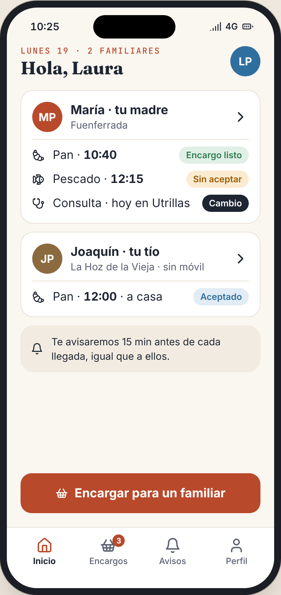

# Claxon

*El radar de lo que pasa por tu pueblo.*

Proyecto final de 2.º de DAM. Claxon es una app para pueblos pequeños de Teruel que avisa de cuándo llega el panadero, el pescadero o el médico, y deja hacer encargos antes de que lleguen.

  

## Cuatro perfiles

| Perfil | Qué hace |
|---|---|
| **Vecino** | Recibe avisos 15 minutos antes de que llegue cada servicio y hace encargos. |
| **Familiar** | Ayuda desde fuera del pueblo: ve los avisos y encarga en nombre de su familiar, aunque este no tenga móvil. |
| **Vendedor** | Pulsa «Iniciar ruta» y «He llegado». El servidor calcula las horas y avisa a los vecinos. |
| **Ayuntamiento** | Publica avisos y cambios de la consulta médica (sin datos clínicos). |

Además hay un **tablón web** para la tele del bar o del local social, pensado para quien no usa el móvil.

## Tecnología

| Parte | Tecnología |
|---|---|
| App móvil, panel web y tablón | Flutter |
| API REST | Java 21 + Spring Boot (roles con Spring Security, tareas programadas) |
| Base de datos | PostgreSQL 16 |
| Notificaciones | Firebase Cloud Messaging |
| Herramientas | Docker, GitHub, Figma, Postman / Swagger |

## Qué hay en el repositorio

```
├── database/                 Base de datos: esquema, datos demo y pruebas
│   ├── 01_esquema.sql        10 tablas, índices y vistas
│   ├── 02_datos_demo.sql     Pueblos de las Cuencas Mineras, rutas, encargos...
│   ├── 03_pruebas.sql        43 pruebas de integridad
│   └── herramientas/         Genera los diagramas desde la base de datos real
├── docs/
│   ├── base-de-datos/        Diagrama entidad-relación (interactivo, PNG, Mermaid, DBML) y decisiones de diseño
│   ├── interfaces/           34 pantallas con datos demo (catálogo HTML, PNG y PDF)
│   └── videos/               Un anuncio en vídeo por perfil
├── docker-compose.yml        PostgreSQL + Adminer
└── .env.example
```

## Arrancar la base de datos

Necesitas [Docker Desktop](https://www.docker.com/products/docker-desktop/).

```bash
docker compose up -d
```

- PostgreSQL queda en `localhost:5432` (usuario `claxon`, contraseña `claxon`, base de datos `claxon`) con los datos demo cargados.
- **Adminer**, para ver las tablas en el navegador: <http://localhost:8081> (sistema *PostgreSQL*, servidor `db`).
- Usuarios demo y contraseña: [docs/base-de-datos](docs/base-de-datos/README.md#usuarios-demo).

## Documentación

- **[Base de datos](docs/base-de-datos/README.md)**: diagrama, los 8 bloques y por qué está diseñada así.
- **[Interfaces](docs/interfaces/README.md)**: todas las pantallas, perfil por perfil.
- **[Anuncios en vídeo](docs/videos/README.md)**: un vídeo de 30 segundos por perfil.
- **[Sugerencias](docs/sugerencias.md)**: orden de desarrollo, preguntas del tribunal, privacidad y validación con usuarios.

## Objetivo de Desarrollo Sostenible

Claxon se alinea con el **ODS 11, Ciudades y comunidades sostenibles** (meta 11.a): inclusión (letra grande, compatible con TalkBack), vida en el medio rural y coordinación entre vecinos, vendedores y ayuntamientos.
