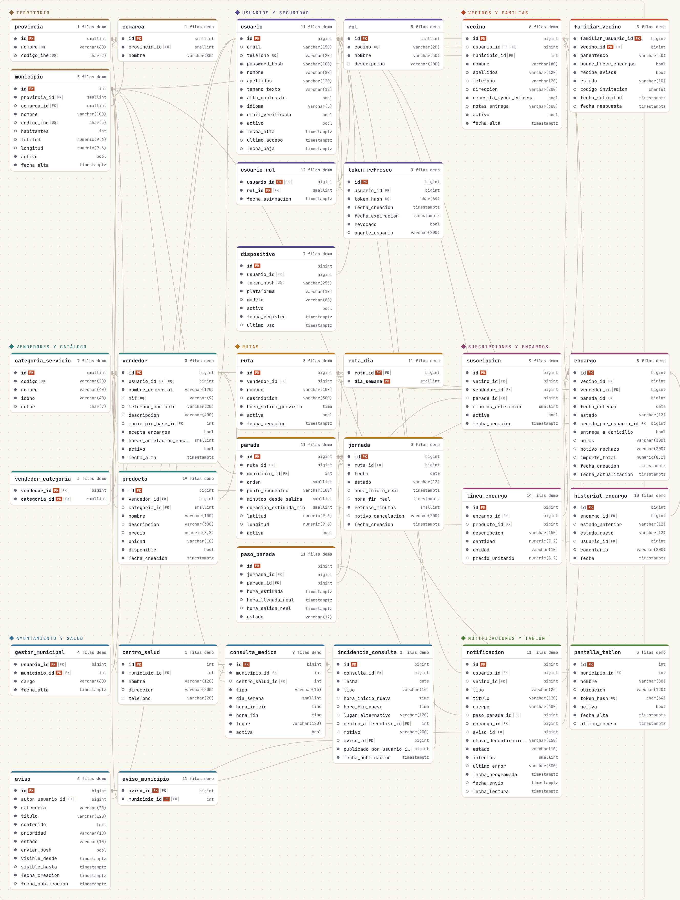

# Base de datos de Claxon

PostgreSQL 16 · 31 tablas en 8 bloques · 53 relaciones · 5 vistas · 6 triggers · 50 reglas CHECK · 36 pruebas automáticas.



## Cómo verla

| Archivo | Para qué |
|---|---|
| [`diagrama-er.html`](diagrama-er.html) | **Diagrama interactivo.** Descárgalo y ábrelo con doble clic: pulsa una tabla y ves sus columnas, a qué apunta, quién la usa y sus reglas. Tiene buscador y zoom. |
| [`diagrama-er.png`](diagrama-er.png) | El mismo mapa como imagen (para la memoria o la presentación). |
| [`diagramas.md`](diagramas.md) | Diagramas Mermaid por bloque. GitHub los dibuja directamente. |
| [`claxon.dbml`](claxon.dbml) | Para [dbdiagram.io](https://dbdiagram.io): *Import → DBML*. Permite mover las tablas a mano y exportar a PDF. |
| [`modelo.json`](modelo.json) | El modelo en JSON (lo usa el diagrama interactivo). |

Todos se generan desde la base de datos real con `database/herramientas/exportar_modelo.py`. **No se editan a mano**: se cambia el SQL y se vuelve a ejecutar el script.

## Arrancarla

```bash
docker compose up -d          # PostgreSQL en localhost:5432 + Adminer en http://localhost:8081
```

- La primera vez carga `01_esquema.sql` y `02_datos_demo.sql` automáticamente.
- **Adminer** (ver y editar datos en el navegador): sistema *PostgreSQL*, servidor `db`, usuario `claxon`, contraseña `claxon`, base de datos `claxon`.
- Para volver a cargar los datos desde cero: `docker compose down -v && docker compose up -d`.
- Para pasar las pruebas: `docker exec claxon-db psql -U claxon -d claxon -f /pruebas/03_pruebas.sql`.

Sin Docker (con PostgreSQL instalado):

```bash
createdb claxon
psql -d claxon -f database/01_esquema.sql -f database/02_datos_demo.sql -f database/03_pruebas.sql
```

## Usuarios demo

Contraseña de todos: **`Claxon2026!`** (guardada como hash BCrypt, igual que lo hará Spring Security).

| Quién | Entra con | Rol | Para probar |
|---|---|---|---|
| María Pérez | `600111222` | Vecina de Fuenferrada | Pantalla «Hoy», encargo preparado, aviso de la consulta |
| Manuel Sanz | `manuel.sanz@demo.claxon` | Vecino de Fuenferrada | Encargo pendiente, solicitud de vínculo familiar |
| Carmen López | `carmen.lopez@demo.claxon` | Vecina de Segura de los Baños | Suscrita al pescado con 30 min de antelación |
| Teresa Aznar | `600777888` | Vecina de Martín del Río | Encargo de fruta para el martes |
| Laura Pérez | `laura.perez@demo.claxon` | Familiar (hija de María, sobrina de Joaquín) | Gestiona a Joaquín, que no tiene móvil |
| Jorge Lázaro | `horno.sanjorge@demo.claxon` | Vendedor (Horno San Jorge) | Ruta del pan **en curso** hoy |
| Antonio Gil | `pescados.gil@demo.claxon` | Vendedor (Pescados Gil) | Ruta del pescado programada hoy |
| Pilar Royo | `frutas.pilar@demo.claxon` | Vendedora (Frutas Pilar) | Ruta martes y jueves |
| Ana Martín | `secretaria@demo.claxon` | Ayuntamiento (Fuenferrada, Segura, La Hoz) | Avisos, cambio de consulta, borrador |
| Luis Navarro | `alcaldia.mdr@demo.claxon` | Ayuntamiento (Martín del Río) y vecino | Usuario con dos roles |
| Equipo Claxon | `admin@claxon.app` | Administrador | Gestión general |

Las fechas de la demo son relativas al día en que se carga: **«hoy» siempre tiene datos** (la ruta del pan va de camino a Fuenferrada para las 10:40, el pescado llega a las 12:15 y la consulta de Fuenferrada se pasa en Utrillas).

## Los 8 bloques

| Bloque | Tablas | Qué guarda |
|---|---|---|
| Territorio | `provincia`, `comarca`, `municipio` | Los pueblos. La comarca agrupa servicios entre pueblos cercanos. |
| Usuarios y seguridad | `usuario`, `rol`, `usuario_rol`, `token_refresco`, `dispositivo` | Cuentas, roles de Spring Security, sesiones JWT y móviles para FCM. |
| Vecinos y familias | `vecino`, `familiar_vecino` | Quién vive en cada pueblo y quién le ayuda desde fuera. |
| Vendedores y catálogo | `categoria_servicio`, `vendedor`, `vendedor_categoria`, `producto` | Panaderos, pescaderos, fruteros... y lo que venden. |
| Rutas | `ruta`, `ruta_dia`, `parada`, `jornada`, `paso_parada` | Por dónde pasa cada vendedor y a qué hora estimada. |
| Suscripciones y encargos | `suscripcion`, `encargo`, `linea_encargo`, `historial_encargo` | Quién quiere aviso de qué vendedor y los pedidos. |
| Ayuntamiento y salud | `gestor_municipal`, `centro_salud`, `consulta_medica`, `incidencia_consulta`, `aviso`, `aviso_municipio` | Avisos municipales y horario de consulta médica (sin datos clínicos). |
| Notificaciones y tablón | `notificacion`, `pantalla_tablon` | Los push enviados (sin duplicados) y las pantallas de los bares. |

## Decisiones de diseño (para defenderlas en el tribunal)

**1. `vecino` y `usuario` son tablas distintas.** Muchas personas mayores no tienen móvil. Un vecino puede existir sin cuenta (`vecino.usuario_id` es NULL) y lo gestiona un familiar. Joaquín, en la demo, es así: los avisos de su encargo le llegan a su sobrina Laura.

**2. Plantilla e instancia: `ruta` → `jornada` → `paso_parada`.** La `ruta` es el recorrido habitual («lunes a sábado a las 9:45»). La `jornada` es esa ruta un día concreto. El `paso_parada` es el paso por cada pueblo ese día, con su **hora estimada** y la real. Así se guarda el histórico y se pueden calcular retrasos medios.

**3. La hora estimada no necesita GPS.** `hora_estimada = hora de inicio real + parada.minutos_desde_salida + jornada.retraso_minutos`. Si el vendedor avisa de 10 minutos de retraso, se mueven todas las paradas que faltan.

**4. «Un solo aviso, sin duplicados» lo garantiza la base de datos.** Cada notificación tiene una `clave_deduplicacion` única, por ejemplo `LLEGADA_PROXIMA:<paso_parada>:<usuario>`. Aunque la tarea programada se ejecute dos veces, el segundo `INSERT` falla y no se manda otro push. La vista `v_destinatarios_llegada` ya calcula a quién avisar y a qué hora.

**5. El encargo no apunta a la jornada.** Un encargo se hace para una `parada` y una `fecha_entrega`, porque la jornada de mañana todavía no existe. Con esas dos cosas se encuentra el paso del vendedor.

**6. Reglas que cruzan tablas → triggers.** Por ejemplo, que un encargo se haga en una parada **del mismo vendedor**, o que un paso de parada sea de la ruta de su jornada. Un `CHECK` no puede mirar otras tablas, así que se usan triggers.

**7. Historial automático.** Cada cambio de estado de un encargo se guarda en `historial_encargo` mediante un trigger. El backend indica quién hizo el cambio con `SET LOCAL claxon.usuario_id = '6'`.

**8. Sin datos de salud.** `consulta_medica` e `incidencia_consulta` solo guardan días, horas y lugares. El motivo de un cambio es genérico («vacaciones», «formación»). Así se evita tratar datos especialmente protegidos (art. 9 del RGPD).

**9. Estados como `VARCHAR` + `CHECK`, no `ENUM` de PostgreSQL.** Encajan directamente con `@Enumerated(EnumType.STRING)` de JPA, y añadir un estado nuevo solo requiere cambiar el `CHECK`.

**10. Fechas con zona horaria.** Las horas de paso son `TIMESTAMPTZ` y la base de datos trabaja en `Europe/Madrid`. Así los cambios de hora de marzo y octubre no descuadran los avisos.

**11. No se borra, se desactiva.** Usuarios, pueblos, rutas y productos tienen `activo` (y `fecha_baja` en usuario). Así se conserva el histórico de encargos.

**12. Accesibilidad en el modelo.** `usuario.tamano_texto` (por defecto `GRANDE`) y `alto_contraste` se guardan en el servidor: si un familiar configura el móvil de su madre, la preferencia se mantiene aunque cambie de teléfono.

## Conexión desde Spring Boot

```yaml
# backend/src/main/resources/application.yml
spring:
  datasource:
    url: jdbc:postgresql://localhost:5432/claxon
    username: claxon
    password: claxon
  jpa:
    hibernate:
      ddl-auto: validate          # Hibernate comprueba las entidades contra este esquema; no lo modifica
    properties:
      hibernate:
        default_schema: claxon
        jdbc.time_zone: Europe/Madrid
```

Cuando exista el backend, lo recomendable es mover `01_esquema.sql` a `src/main/resources/db/migration/V1__esquema_inicial.sql` y usar **Flyway**: cada cambio futuro será un `V2__...sql`, `V3__...sql`, y así la base de datos de los dos miembros del equipo estará siempre igual.
