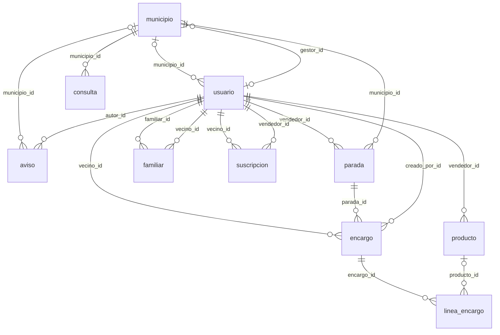
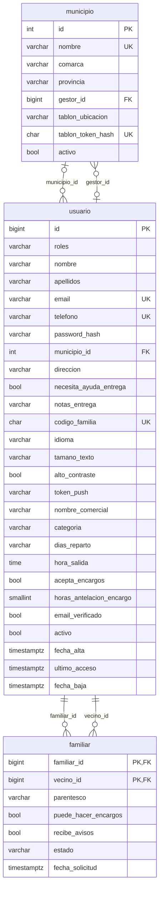
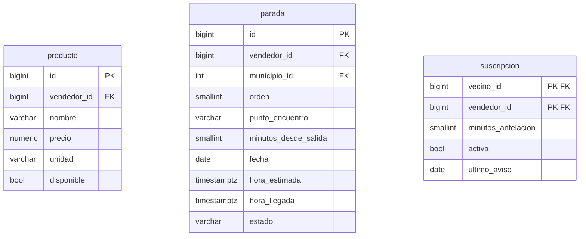
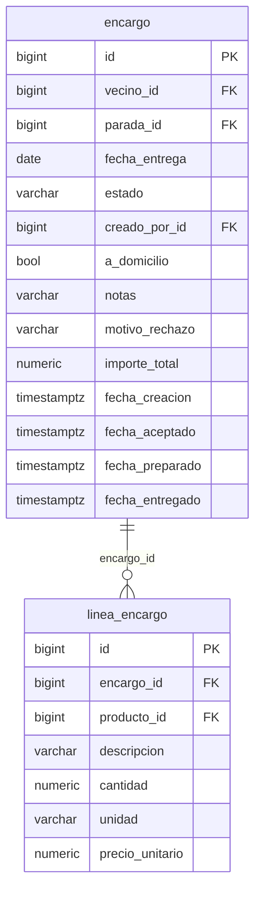
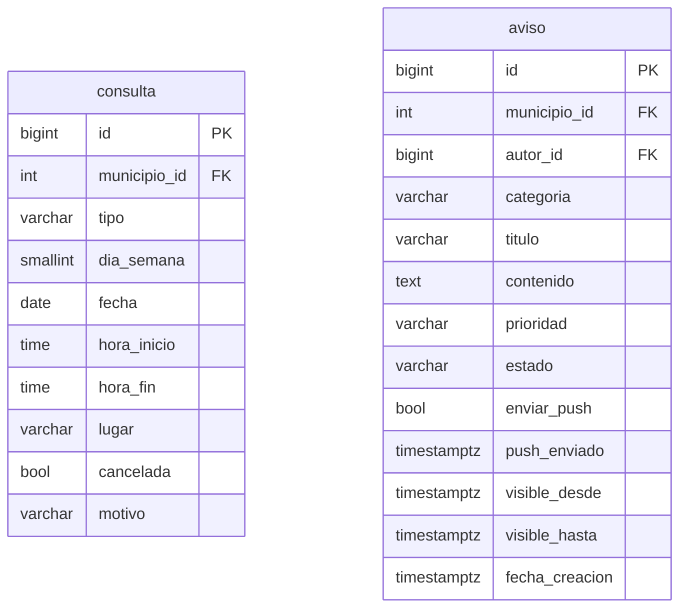

# Diagramas de la base de datos

> Generado automáticamente con `database/herramientas/exportar_modelo.py` a partir de la base de datos real.
> No lo edites a mano: cambia el SQL y vuelve a ejecutar el script.

**10 tablas · 107 columnas · 17 relaciones · 5 vistas · 1 triggers · 40 reglas CHECK · 27 índices**

Cómo leer las relaciones: `||` exactamente uno · `|o` / `o|` cero o uno · `o{` cero o muchos.

## Vista general

Todas las tablas y cómo se relacionan (sin columnas, para que se lea bien).

## Pueblos y personas

- **`municipio`** · Pueblos donde funciona Claxon.
- **`usuario`** · Todas las personas: vecinos, familiares, vendedores, ayuntamiento y administración.
- **`familiar`** · Quién ayuda a quién: un familiar puede ayudar a varios vecinos y un vecino tener varios familiares.

## Vendedores

- **`producto`** · Catálogo del vendedor. Precio orientativo (NULL = según peso).
- **`parada`** · Paradas de la ruta del vendedor, en orden, y cómo va cada una hoy.
- **`suscripcion`** · De qué vendedores quiere aviso cada vecino y con cuánta antelación.

## Encargos

- **`encargo`** · Pedido para recoger cuando pase el vendedor. El vendedor es el de la parada. Se paga en mano.
- **`linea_encargo`** · Cada producto del encargo.

## Ayuntamiento

- **`consulta`** · Horario de consulta médica. Con dia_semana es el horario habitual; con fecha, un cambio de ese día.
- **`aviso`** · Avisos del ayuntamiento. Si va a dos pueblos, se guarda una fila por pueblo.

## Vistas

| Vista | Para qué sirve |
|---|---|
| `v_avisos_llegada` | A quién avisar de cada llegada y a qué hora (vecino y familiares). La lee la tarea programada. |
| `v_avisos_vigentes` | Avisos del ayuntamiento que se ven ahora en cada pueblo. |
| `v_consultas_hoy` | Consulta médica de hoy por pueblo; situacion = NORMAL, CAMBIO o CANCELADA. |
| `v_encargos_parada` | Encargos con el nombre del vecino y un resumen de productos, para el vendedor. |
| `v_servicios_hoy` | Qué vendedores pasan hoy por cada pueblo, a qué hora estimada y cómo van. |

## Triggers

| Tabla | Trigger | Función |
|---|---|---|
| `encargo` | `tg_encargo_fechas` | `fn_encargo_fechas()` |
