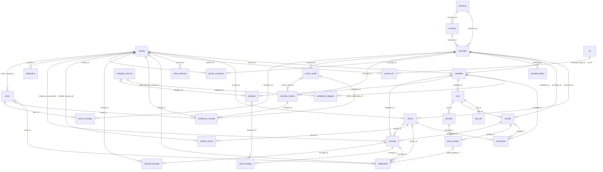
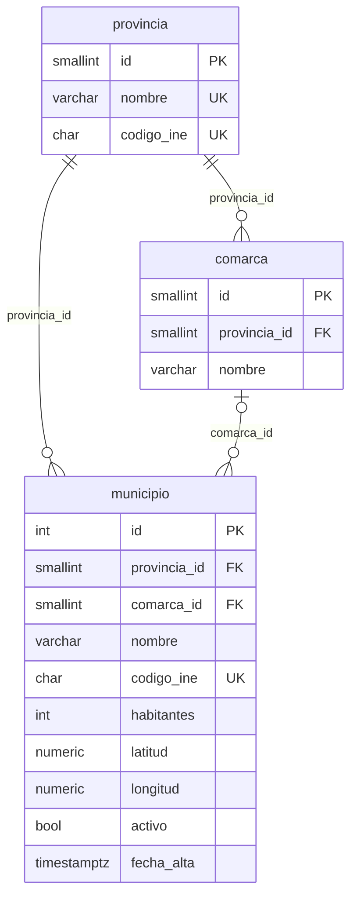
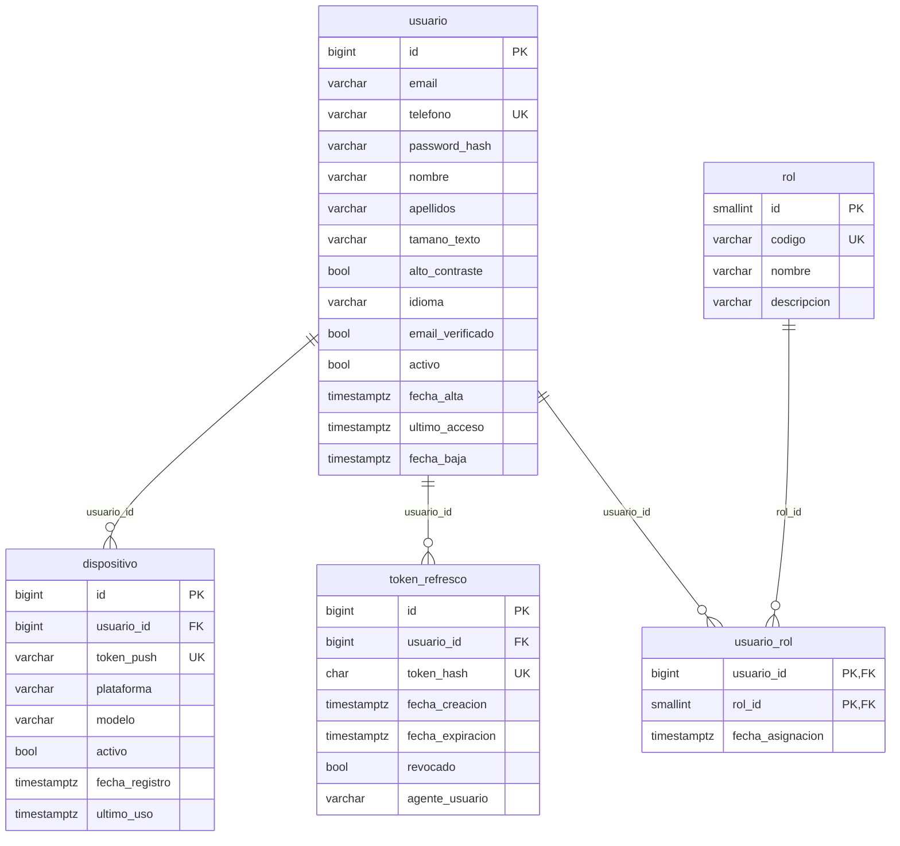
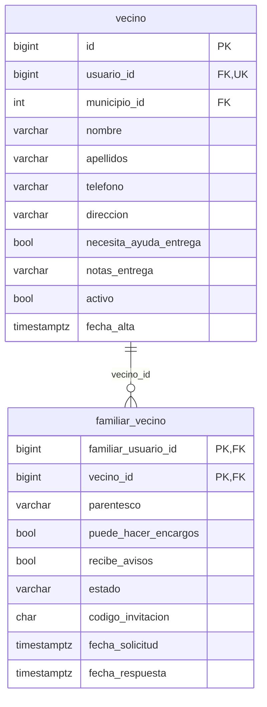
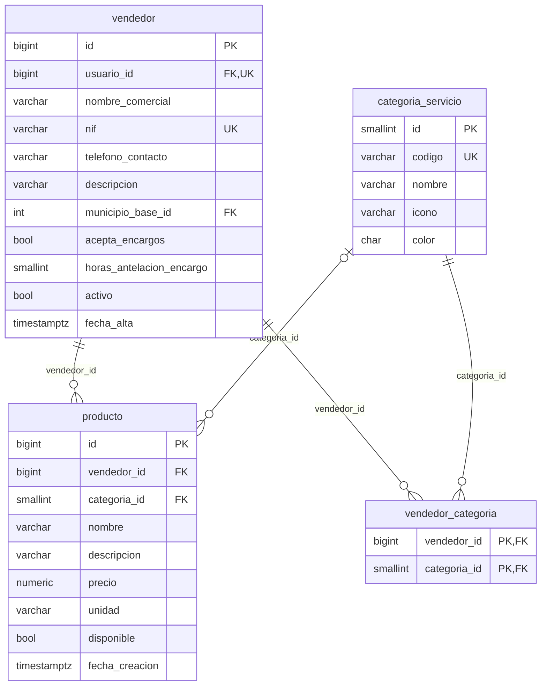
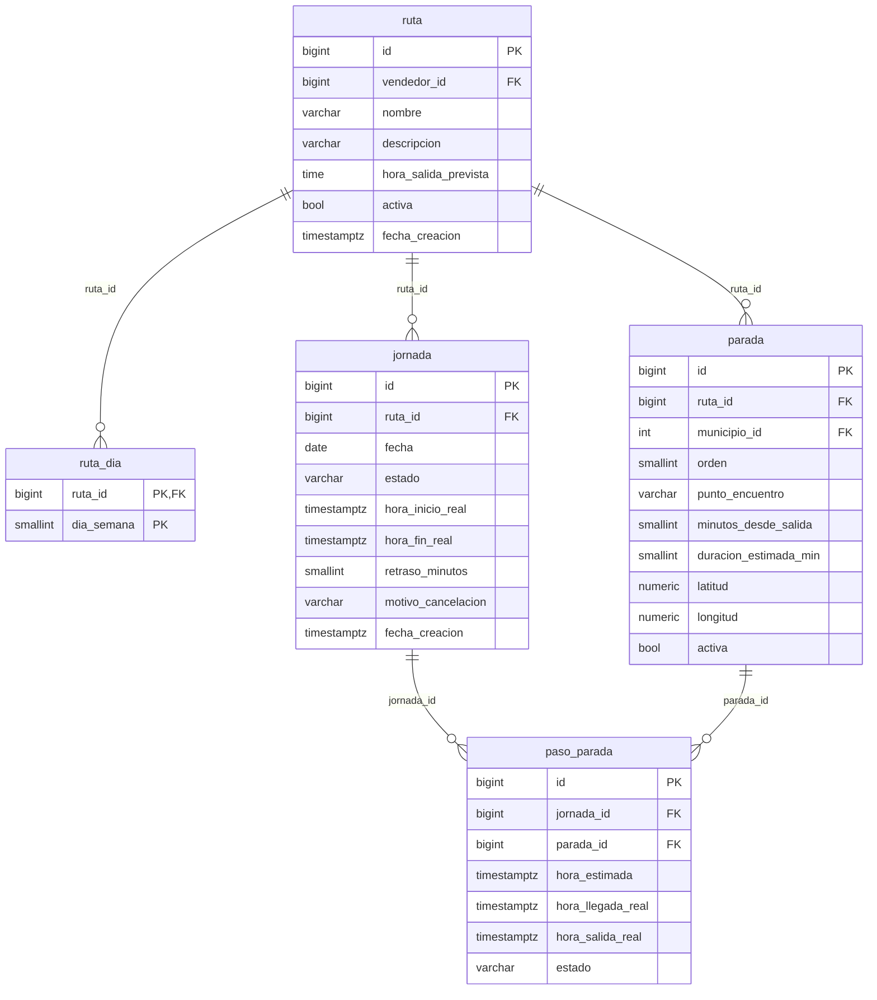
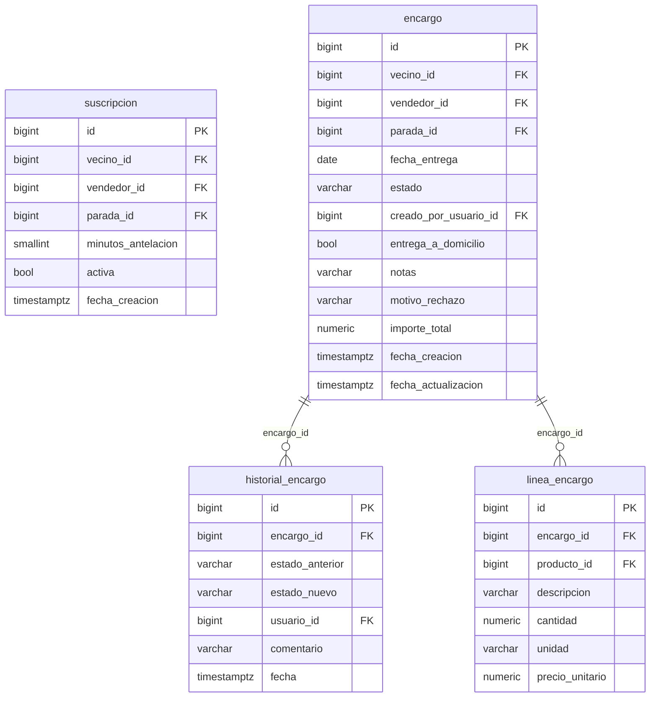
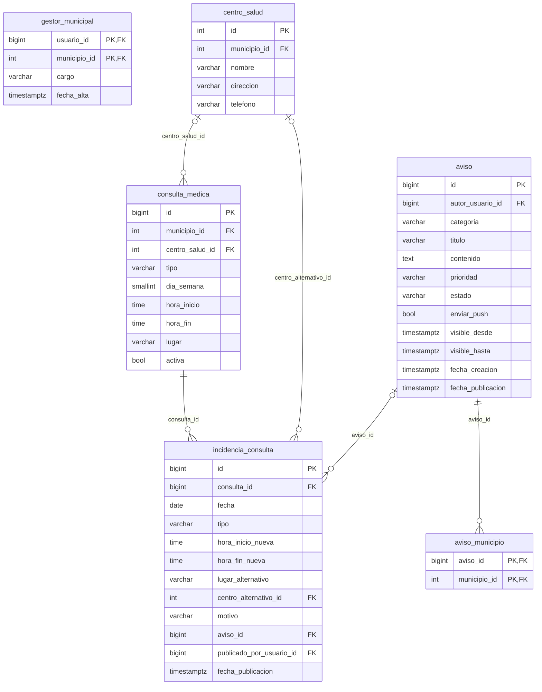
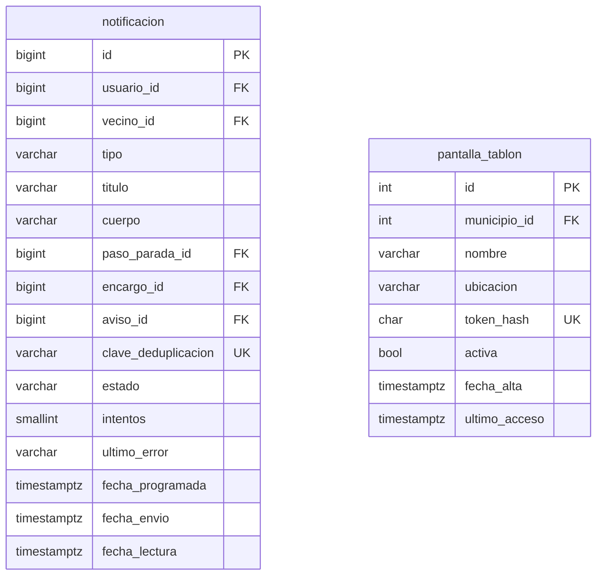

# Diagramas de la base de datos

> Generado automáticamente con `database/herramientas/exportar_modelo.py` a partir de la base de datos real.
> No lo edites a mano: cambia el SQL y vuelve a ejecutar el script.

**31 tablas · 236 columnas · 53 relaciones · 5 vistas · 6 triggers · 50 reglas CHECK · 80 índices**

Cómo leer las relaciones: `||` exactamente uno · `|o` / `o|` cero o uno · `o{` cero o muchos.

## Vista general

Todas las tablas y cómo se relacionan (sin columnas, para que se lea bien).

## Territorio

- **`provincia`** · Provincias donde opera Claxon (el piloto empieza en Teruel).
- **`comarca`** · Comarcas (en Aragón agrupan servicios entre pueblos cercanos).
- **`municipio`** · Pueblos dados de alta en Claxon.

## Usuarios y seguridad

- **`usuario`** · Cuenta para entrar en la app o en el panel web. Un usuario puede tener varios roles.
- **`rol`** · Perfiles de la aplicación. Se usan en Spring Security como ROLE_<codigo>.
- **`usuario_rol`** · Relación N:M: un vendedor también puede ser vecino de su pueblo, por ejemplo.
- **`token_refresco`** · Tokens de refresco del JWT. Permite cerrar sesión en un dispositivo concreto.
- **`dispositivo`** · Móviles de cada usuario donde se envían las notificaciones push.

## Vecinos y familias

- **`vecino`** · Persona que vive en el pueblo. Puede NO tener cuenta: en ese caso la gestiona un familiar.
- **`familiar_vecino`** · Familiares que ayudan a un vecino desde fuera del pueblo.

## Vendedores y catálogo

- **`categoria_servicio`** · Tipos de servicio ambulante: pan, pescado, fruta, carne...
- **`vendedor`** · Negocio ambulante (panadería, pescadería...).
- **`vendedor_categoria`** · Un vendedor puede ofrecer varias categorías (p. ej. pan y bollería, fruta y verdura).
- **`producto`** · Catálogo opcional del vendedor. Si no tiene, los encargos se hacen con texto libre.

## Rutas

- **`ruta`** · Plantilla de recorrido habitual de un vendedor (qué pueblos y en qué orden).
- **`ruta_dia`** · Días de la semana en que se hace la ruta.
- **`parada`** · Punto donde para el vendedor en cada pueblo de la ruta.
- **`jornada`** · Una ruta en un día concreto. Se crea al pulsar «Iniciar ruta» o la genera una tarea programada.
- **`paso_parada`** · Paso del vendedor por cada parada en una jornada. Aquí vive la hora estimada que ve el vecino.

## Suscripciones y encargos

- **`suscripcion`** · Qué vendedores quiere que le avisen a cada vecino y con cuánta antelación.
- **`encargo`** · Pedido que el vecino deja hecho para recoger cuando pase el vendedor. El pago es en mano.
- **`linea_encargo`** · Cada producto del encargo.
- **`historial_encargo`** · Trazabilidad de los cambios de estado de cada encargo (se rellena con un trigger).

## Ayuntamiento y salud

- **`gestor_municipal`** · Personas del ayuntamiento que publican avisos. N:M porque un secretario suele llevar varios pueblos.
- **`centro_salud`** · Centro de salud de referencia de la zona (p. ej. Utrillas).
- **`consulta_medica`** · Horario semanal habitual de consulta en el pueblo. Sin datos clínicos.
- **`incidencia_consulta`** · Cambio puntual de una consulta: "Hoy no hay consulta, id a Utrillas".
- **`aviso`** · Avisos del ayuntamiento (cortes de agua, cambios de consulta, fiestas...).
- **`aviso_municipio`** · Un aviso puede ir a varios pueblos a la vez (p. ej. toda la comarca).

## Notificaciones y tablón

- **`notificacion`** · Bandeja de avisos de cada usuario y registro de lo enviado por FCM.
- **`pantalla_tablon`** · Pantallas del tablón web (bar, local social). Entran con un enlace secreto, sin usuario.

## Vistas

| Vista | Para qué sirve |
|---|---|
| `v_avisos_vigentes` | Avisos del ayuntamiento que se deben mostrar ahora en cada pueblo. |
| `v_consultas_hoy` | Consulta médica de hoy por pueblo; situacion = NORMAL, CANCELADA, CAMBIO_HORARIO o CAMBIO_LUGAR. |
| `v_destinatarios_llegada` | La usa la tarea programada: cada minuto busca filas con hora_aviso <= now() y crea la notificación (la clave evita duplicados). |
| `v_encargos_parada` | Encargos con el nombre del vecino y un resumen de productos, para la lista del vendedor. |
| `v_servicios_hoy` | Qué servicios pasan hoy por cada pueblo y a qué hora estimada. |

## Triggers

| Tabla | Trigger | Función |
|---|---|---|
| `encargo` | `tg_encargo_fecha_actualizacion` | `fn_tocar_fecha_actualizacion()` |
| `encargo` | `tg_encargo_historial` | `fn_encargo_auditar()` |
| `encargo` | `tg_encargo_validar` | `fn_validar_encargo()` |
| `familiar_vecino` | `tg_familiar_validar` | `fn_validar_familiar()` |
| `paso_parada` | `tg_paso_parada_validar` | `fn_validar_paso_parada()` |
| `suscripcion` | `tg_suscripcion_validar` | `fn_validar_suscripcion()` |
