# Interfaces de Claxon

> Generado por `fuente/construir.py`. Para cambiar una pantalla, edita `fuente/pantallas/*.html` y vuelve a construir.

**[Descargar el PDF](interfaces-claxon.pdf)** (16 páginas, A4 apaisado) · **[Abrir el catálogo completo](interfaces-claxon.html)** (descárgalo y ábrelo con doble clic) · las imágenes sueltas están en [`png/`](png/).

Datos de ejemplo iguales a los de la base de datos demo: lunes 19 de octubre, 10:25. La ruta del pan va de camino a Fuenferrada (10:40), el pescado llega a las 12:15 y la consulta de hoy se pasa en Utrillas.

## Identidad visual

| | |
|---|---|
| Color principal | Terracota `#B8492B` sobre crema `#FAF6F0`, tinta `#1E2532` |
| Titulares | Fraunces (serifa, como la presentación) |
| Texto | Inter, 17 px en la app (más grande que lo habitual) |
| Etiquetas | JetBrains Mono en mayúsculas |
| Iconos | Lucide (los mismos de la presentación) |
| Botones | 58 px de alto como mínimo; 92 px los del vendedor, que va conduciendo |

## Acceso y primeros pasos

*App móvil · Flutter.* Lo primero que ve cualquier persona. Pocos pasos, letra grande y entrada con teléfono, porque mucha gente mayor no usa el correo.

<table>
<tr>
<td valign="top" width="33%">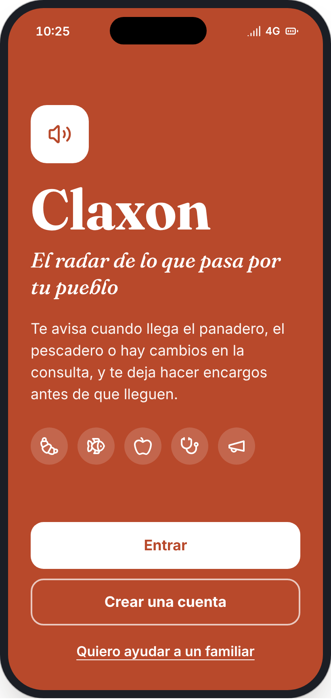<br><b>01 · Todos · Bienvenida</b><br><sub>Portada con la identidad de la presentación. Tres caminos: entrar, crear cuenta o entrar como familiar.</sub></td>
<td valign="top" width="33%">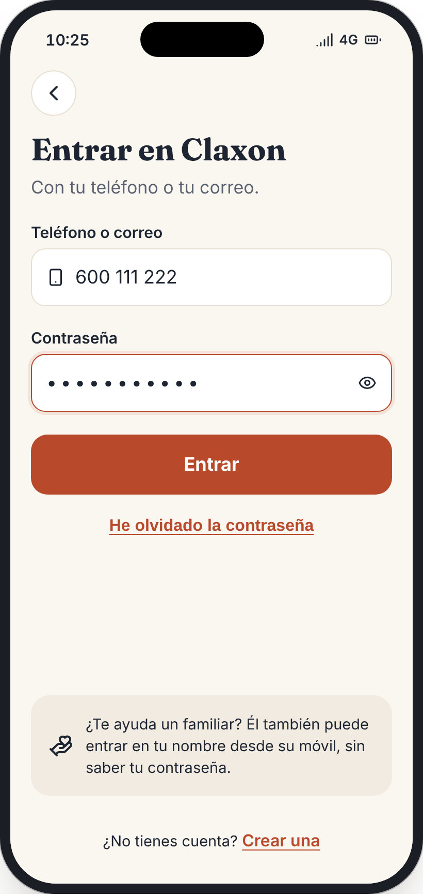<br><b>02 · Todos · Entrar</b><br><sub>Teléfono o correo y contraseña. Campos de 56 px de alto y texto a 18 px.</sub></td>
<td valign="top" width="33%">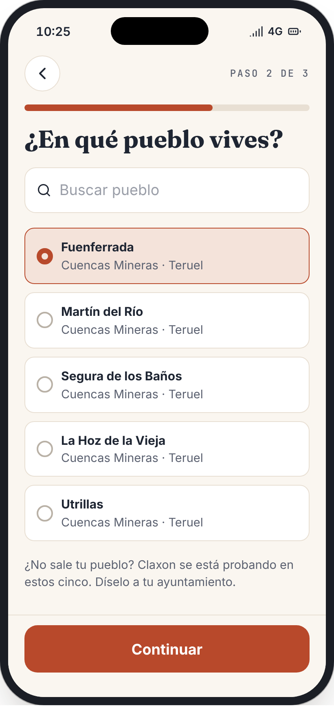<br><b>03 · Vecino · Registro: elegir pueblo</b><br><sub>El pueblo decide qué vendedores y avisos verá. Lista corta: el piloto son 3–4 pueblos.</sub></td>
</tr>
<tr>
<td valign="top" width="33%">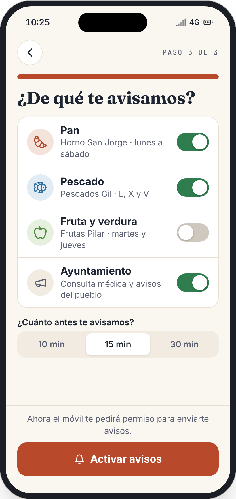<br><b>04 · Vecino · Registro: avisos</b><br><sub>Crea las suscripciones y la antelación (tabla <code>suscripcion</code>). 15 min por defecto, como en la presentación.</sub></td>
</tr>
</table>

## María, vecina de Fuenferrada

*App móvil · Vecino.* La persona que vive en el pueblo. Ve lo que pasa hoy, hace encargos y recibe avisos. Todo cabe en cuatro pestañas: Hoy, Encargos, Avisos y Familia.

<table>
<tr>
<td valign="top" width="33%"><br><b>05 · Vecino · Hoy</b><br><sub>La pantalla principal. Arriba lo urgente (cambio de consulta), después los servicios del día con su hora estimada y el encargo preparado. Datos de la vista <code>v_servicios_hoy</code>.</sub></td>
<td valign="top" width="33%">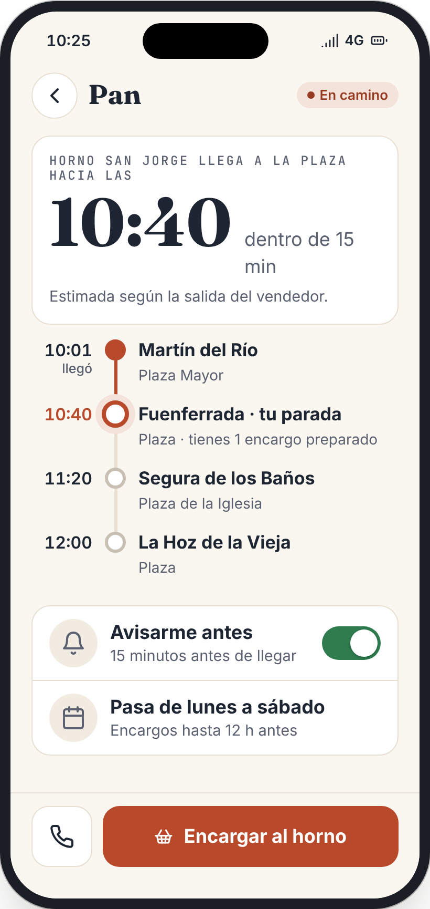<br><b>06 · Vecino · Detalle de un servicio</b><br><sub>Recorrido de hoy con las paradas hechas y las que faltan (estado de hoy de cada <code>parada</code>). Deja claro que es una estimación, no GPS.</sub></td>
<td valign="top" width="33%">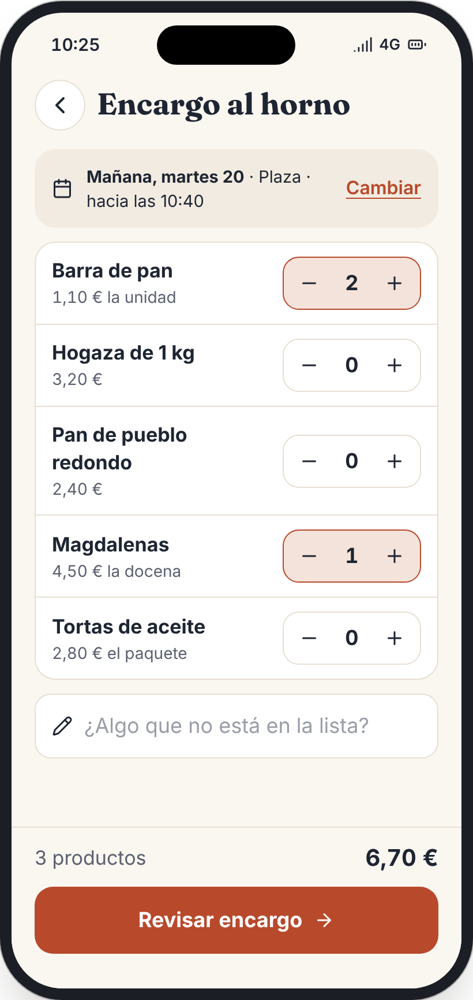<br><b>07 · Vecino · Hacer un encargo</b><br><sub>Catálogo del vendedor con botones − / + grandes. Si el producto no está, se escribe (línea con <code>producto_id</code> vacío). Para mañana: el horno pide 12 h de antelación.</sub></td>
</tr>
<tr>
<td valign="top" width="33%">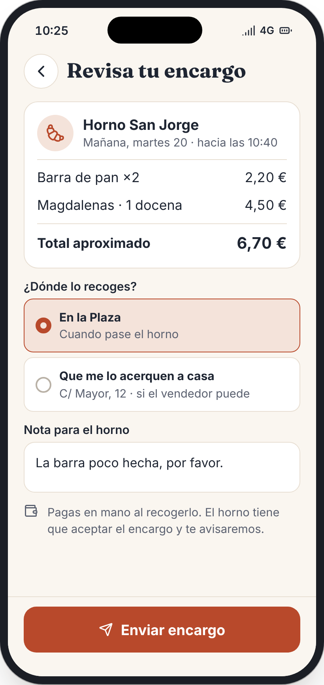<br><b>08 · Vecino · Revisar y enviar</b><br><sub>Resumen, lugar de recogida (<code>a_domicilio</code>) y nota. Sin pagos dentro de la app: se paga en mano, como ahora.</sub></td>
<td valign="top" width="33%">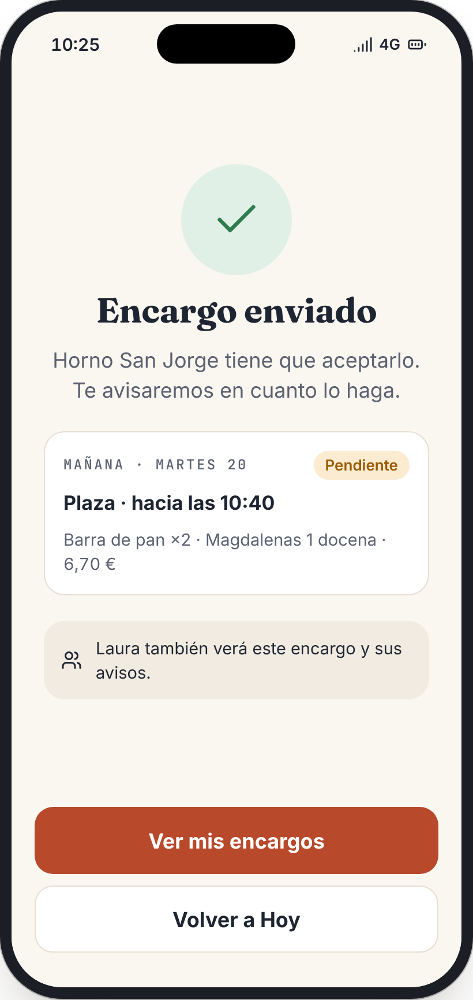<br><b>09 · Vecino · Encargo enviado</b><br><sub>Confirmación clara. Recuerda que el familiar vinculado también lo ve (<code>familiar.recibe_avisos</code>).</sub></td>
<td valign="top" width="33%">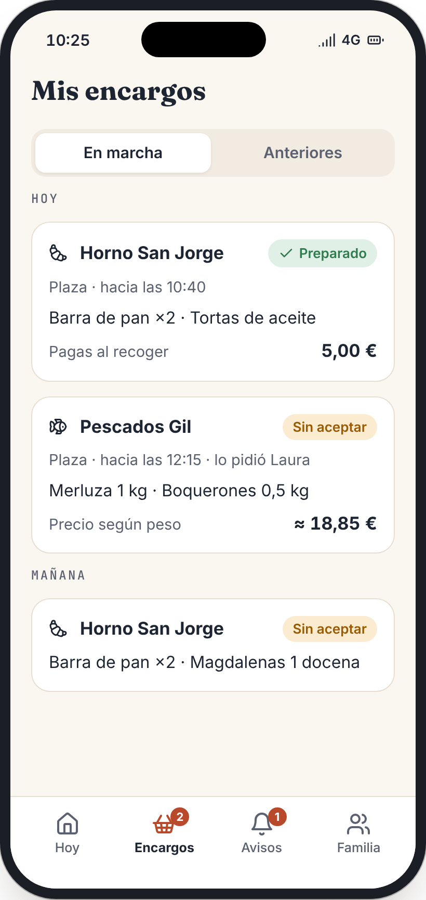<br><b>10 · Vecino · Mis encargos</b><br><sub>Agrupados por día con su estado en color y texto. Si lo pidió un familiar, se dice (<code>creado_por_id</code>).</sub></td>
</tr>
<tr>
<td valign="top" width="33%">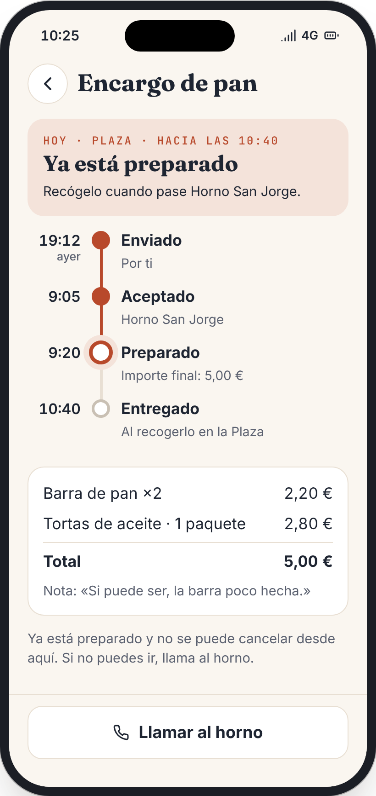<br><b>11 · Vecino · Detalle del encargo</b><br><sub>Cada paso es una fecha del encargo (<code>fecha_aceptado</code>, <code>fecha_preparado</code>...) que rellena un trigger. Explica por qué no se puede cancelar en vez de esconder el botón.</sub></td>
<td valign="top" width="33%">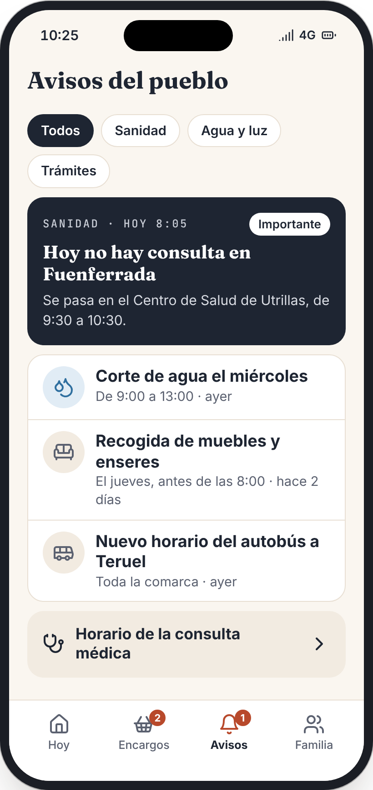<br><b>12 · Vecino · Avisos del pueblo</b><br><sub>Los avisos vigentes del ayuntamiento (vista <code>v_avisos_vigentes</code>). Los importantes, arriba y en oscuro.</sub></td>
<td valign="top" width="33%">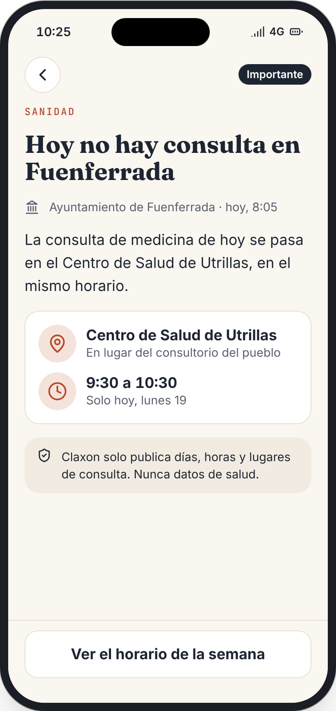<br><b>13 · Vecino · Detalle de un aviso</b><br><sub>Lo publica el ayuntamiento al registrar un cambio (una fila de <code>consulta</code> con fecha + un <code>aviso</code>). Lo importante en texto grande y en dos datos: dónde y cuándo.</sub></td>
</tr>
<tr>
<td valign="top" width="33%">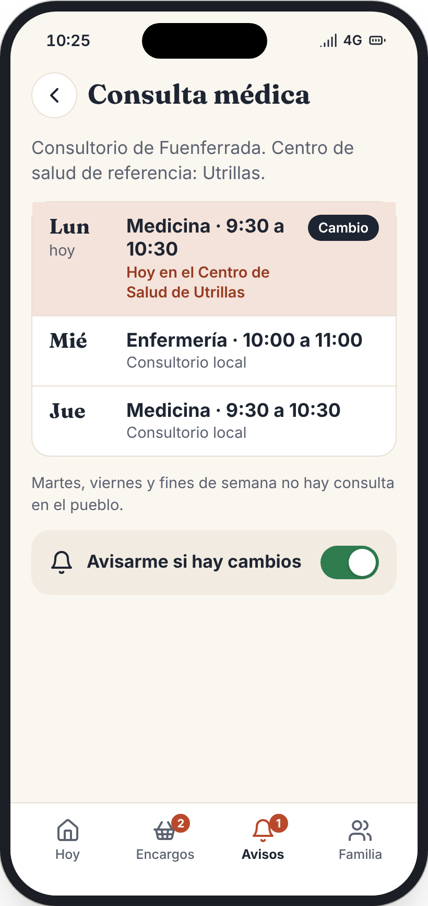<br><b>14 · Vecino · Horario de consulta</b><br><sub>Semana tipo (filas de <code>consulta</code> con día de la semana) con el cambio de hoy encima (vista <code>v_consultas_hoy</code>).</sub></td>
<td valign="top" width="33%">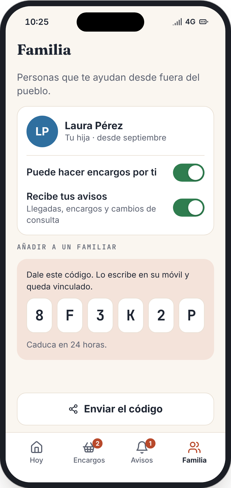<br><b>15 · Vecino · Familia</b><br><sub>Quién ayuda a María y qué puede hacer (<code>familiar</code>). Se vincula con su <code>codigo_familia</code> de 6 caracteres, sin compartir la contraseña.</sub></td>
<td valign="top" width="33%">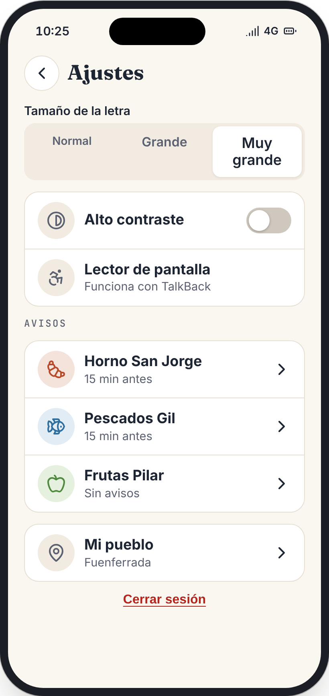<br><b>16 · Vecino · Ajustes y accesibilidad</b><br><sub>Letra grande por defecto, alto contraste y TalkBack. La preferencia se guarda en el servidor (<code>usuario.tamano_texto</code>), así se mantiene si cambia de móvil.</sub></td>
</tr>
<tr>
<td valign="top" width="33%">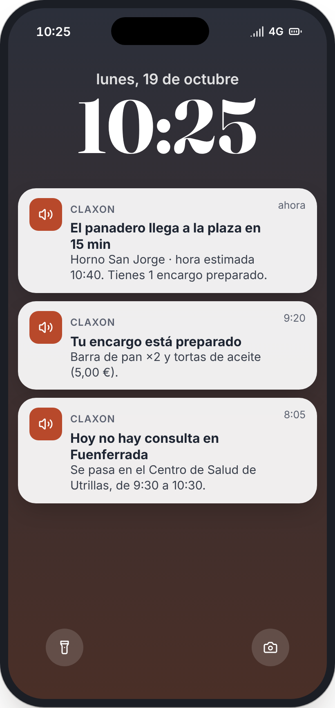<br><b>17 · Vecino y familiar · Notificaciones push</b><br><sub>Lo que llega por Firebase Cloud Messaging. Un aviso por llegada y día: <code>suscripcion.ultimo_aviso</code> evita repetidos.</sub></td>
</tr>
</table>

## Laura, hija de María y sobrina de Joaquín

*App móvil · Familiar.* Vive fuera del pueblo y ayuda sin tener que llamar cada día. Ve lo mismo que sus familiares y puede encargar por ellos. Joaquín no tiene móvil: su perfil lo gestiona Laura.

<table>
<tr>
<td valign="top" width="33%"><br><b>18 · Familiar · Inicio del familiar</b><br><sub>Un resumen por persona: lo que pasa hoy por su pueblo y cómo van sus encargos.</sub></td>
<td valign="top" width="33%">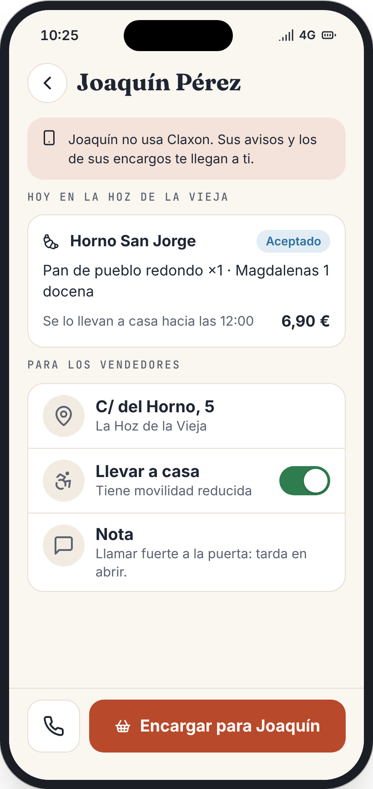<br><b>19 · Familiar · Familiar sin móvil</b><br><sub>Un <code>usuario</code> VECINO sin contraseña. Se guarda si necesita que le lleven las cosas a casa y una nota para el vendedor, sin datos de salud.</sub></td>
<td valign="top" width="33%">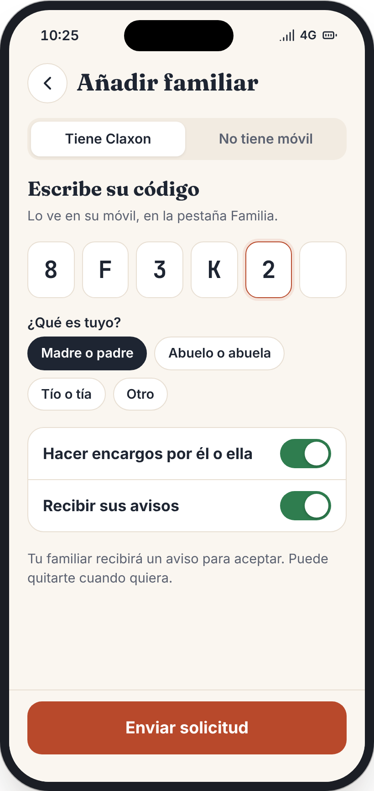<br><b>20 · Familiar · Vincular con código</b><br><sub>Busca al vecino por su <code>codigo_familia</code> y crea la fila de <code>familiar</code> en PENDIENTE hasta que acepta.</sub></td>
</tr>
<tr>
<td valign="top" width="33%">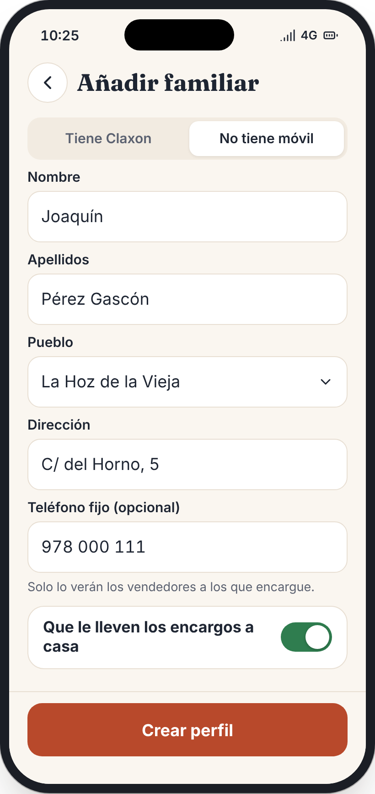<br><b>21 · Familiar · Crear perfil sin móvil</b><br><sub>Da de alta a un vecino que no usará la app. Es un <code>usuario</code> sin contraseña, vinculado al familiar como ACEPTADO.</sub></td>
</tr>
</table>

## Jorge, de Horno San Jorge

*App móvil · Vendedor.* Va conduciendo, así que todo es de un toque y con botones enormes: «Iniciar ruta» y «He llegado». El servidor calcula las horas y avisa a los vecinos.

<table>
<tr>
<td valign="top" width="33%">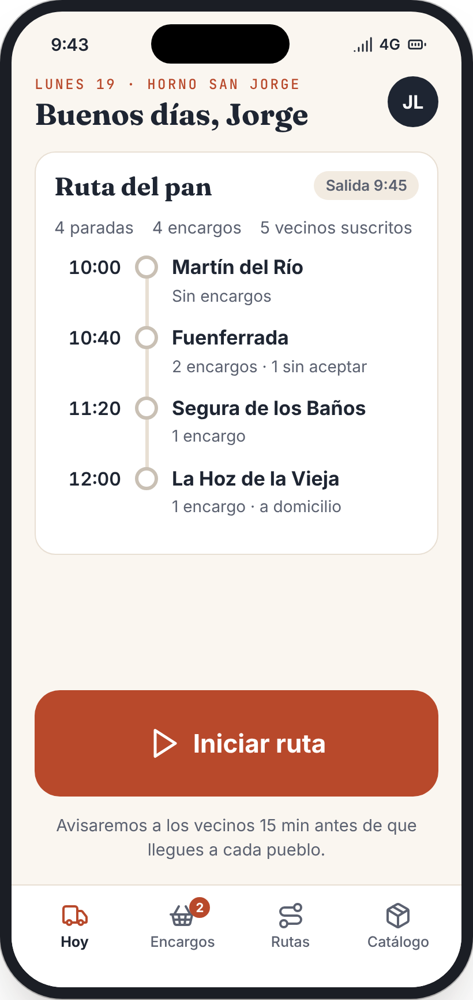<br><b>22 · Vendedor · Antes de salir</b><br><sub>Resumen de la ruta del día. «Iniciar ruta» calcula la hora estimada de cada <code>parada</code> con la hora real de salida.</sub></td>
<td valign="top" width="33%"><br><b>23 · Vendedor · Ruta en curso</b><br><sub>Un solo botón grande para la siguiente parada. Al pulsarlo se guarda <code>parada.hora_llegada</code> y los vecinos ven «Ha llegado».</sub></td>
<td valign="top" width="33%">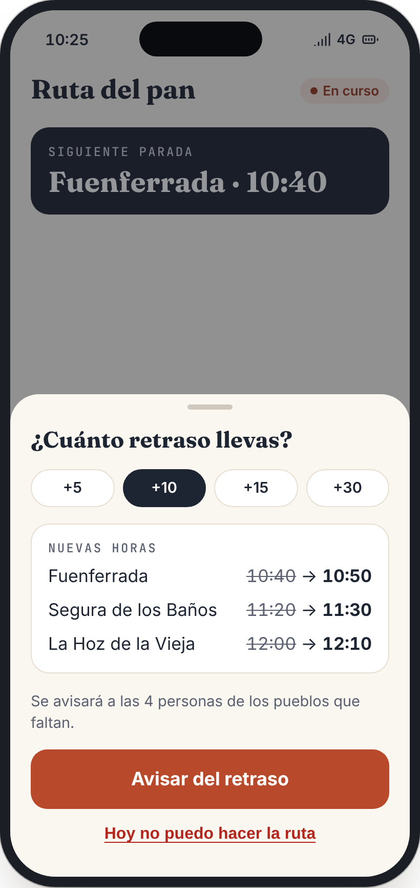<br><b>24 · Vendedor · Avisar de un retraso</b><br><sub>Suma los minutos a la <code>hora_estimada</code> de las paradas que faltan. También permite cancelar la ruta del día.</sub></td>
</tr>
<tr>
<td valign="top" width="33%">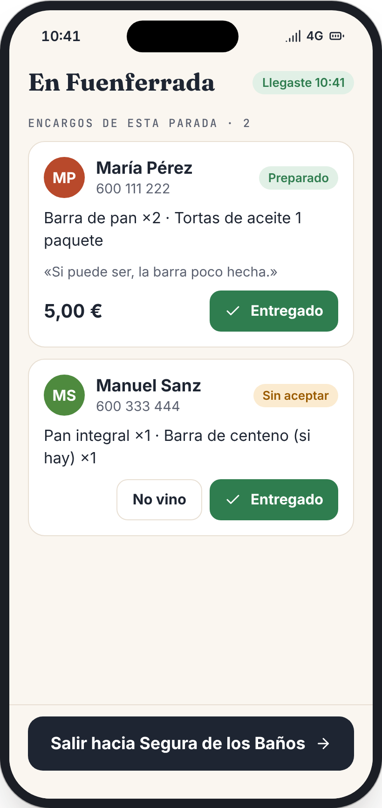<br><b>25 · Vendedor · En la parada</b><br><sub>Lo que ve al pulsar «He llegado»: los encargos de esa parada (vista <code>v_encargos_parada</code>). Marcar «Entregado» o «No vino» cambia el estado del encargo.</sub></td>
<td valign="top" width="33%">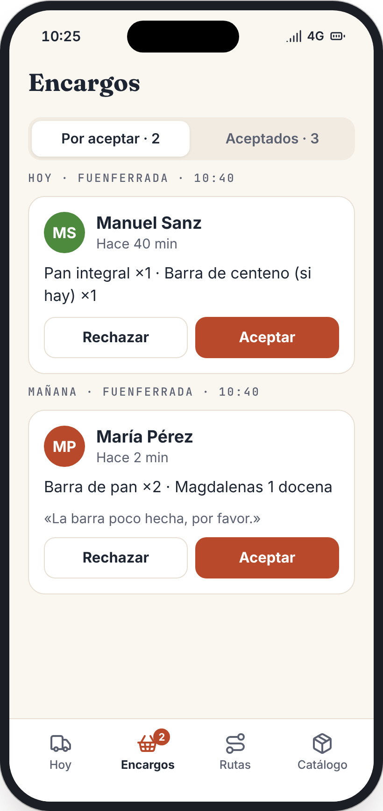<br><b>26 · Vendedor · Encargos por aceptar</b><br><sub>Todos los encargos llegan a un único sitio, en vez de por WhatsApp, llamadas y notas. Rechazar pide un motivo (CHECK <code>ck_encargo_rechazo</code>).</sub></td>
<td valign="top" width="33%">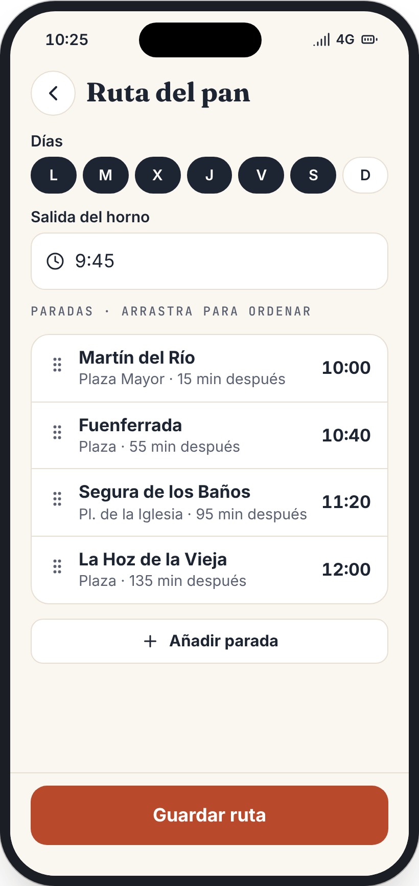<br><b>27 · Vendedor · Editar ruta</b><br><sub>Días (<code>dias_reparto</code>), hora de salida y paradas con los minutos desde la salida (<code>parada.minutos_desde_salida</code>). Así se calculan las horas estimadas.</sub></td>
</tr>
<tr>
<td valign="top" width="33%">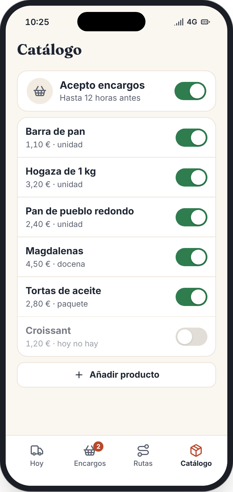<br><b>28 · Vendedor · Catálogo</b><br><sub>Productos con precio orientativo (<code>producto</code>). Desactivar uno lo oculta a los vecinos ese día sin borrarlo.</sub></td>
</tr>
</table>

## Ana, secretaria de tres ayuntamientos

*Panel web · Flutter Web.* En los pueblos pequeños, una misma secretaria lleva varios ayuntamientos. Desde el ordenador publica avisos, registra cambios de la consulta y vigila que los tablones funcionan.

### 29 · Ayuntamiento · Inicio del panel

Resumen del pueblo elegido (Ana es la gestora de tres: `municipio.gestor_id`). Lo de hoy, los avisos publicados y la consulta de la semana.

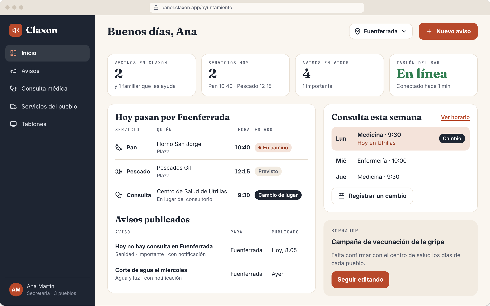

### 30 · Ayuntamiento · Escribir un aviso

Formulario con vista previa de cómo llegará al móvil y al tablón. Si va a varios pueblos se guarda un `aviso` por pueblo. Se puede dejar como borrador.

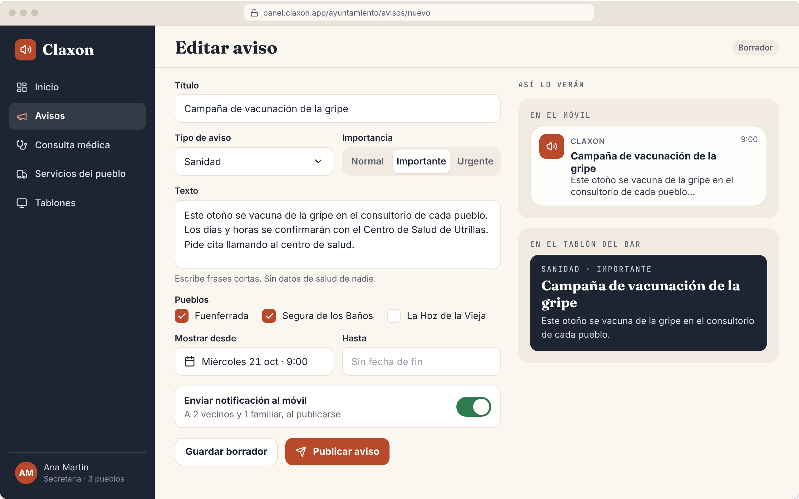

### 31 · Ayuntamiento · Consulta médica

Horario semanal y formulario para un cambio puntual. Al guardarlo se crea el aviso y la notificación automáticamente; así no se le olvida a nadie avisar.

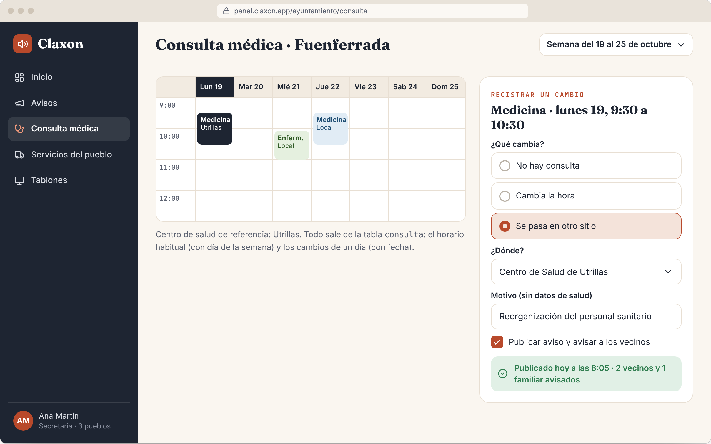

### 32 · Ayuntamiento · Lista de avisos

Todos los avisos de sus pueblos con su estado (`BORRADOR`, `PUBLICADO`, `ARCHIVADO`), alcance y si se mandó notificación.

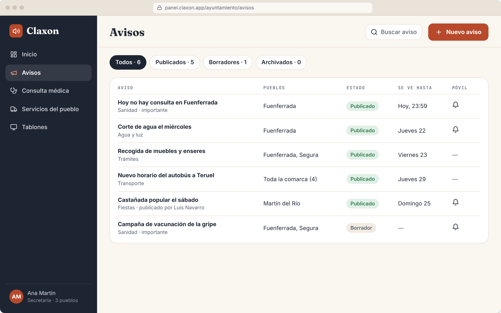

## El equipo de Claxon

*Panel web · Administración.* Para el piloto: dar de alta pueblos, vendedores y tablones, y comprobar que los avisos salen bien.

### 33 · Administración · Resumen del piloto

Estado de los 5 pueblos, los vendedores y los avisos de llegada de hoy (`suscripcion.ultimo_aviso` y vista `v_avisos_llegada`).

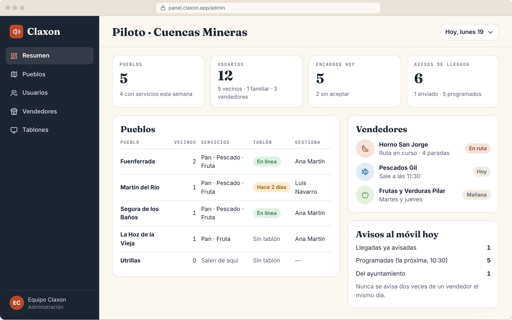

## El tablón del Bar La Plaza

*Tablón web · Pantalla del bar.* Para quien no usa el móvil. Una tele en el bar o el local social abre un enlace secreto y se actualiza sola. Letra enorme, se lee desde la barra.

### 34 · Tablón · Pantalla del bar

Sin usuario ni contraseña: entra con un enlace secreto (`municipio.tablon_token_hash`). Junta las vistas `v_servicios_hoy`, `v_consultas_hoy` y `v_avisos_vigentes`.

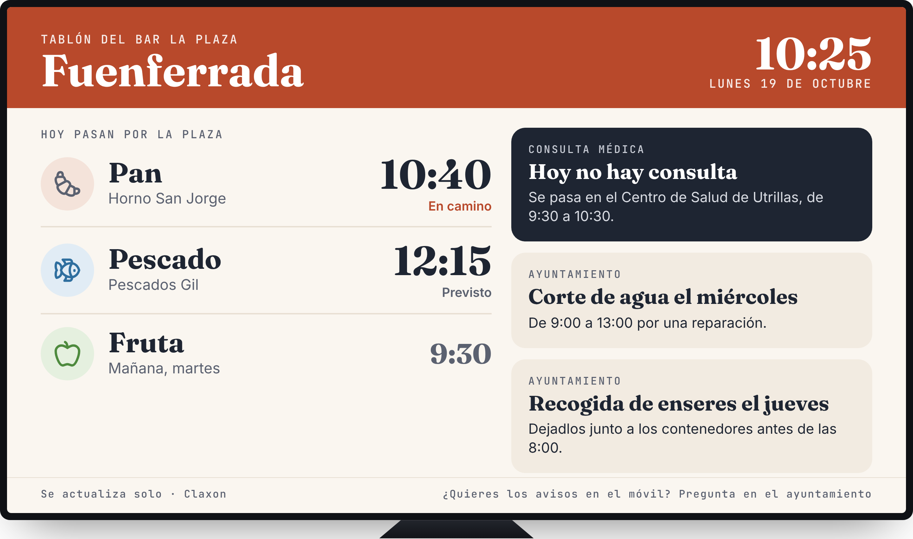

## Regenerar

```bash
cd docs/interfaces/fuente
npm install                 # iconos Lucide y Playwright
python3 construir.py        # → interfaces-claxon.html y este README
npx playwright install chromium   # solo la primera vez
node capturar.js            # → png/
node generar_pdf.js         # → interfaces-claxon.pdf
```
